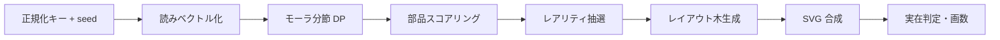
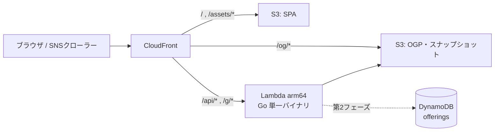

# 架空漢字ガチャ 仕様書

2026-09-22 · @Someone

## 1. 概要

かな5文字以内の「読み」を入力すると、その読みに合いそうな漢字部品を音と意味の両面からスコアリングして選び、合成して漢字一字を生成する。生成される字は実在する場合もしない場合もあり、どちらかは判定して表示する。形態の複雑さはガチャ的に大きくばらつかせる。単純な二部品の字が大半だが、まれに数十画の「グチャグチャ」な字や、幽霊文字・たいと・びゃん系の都市伝説枠も出る。

技術面では、フロントを静的配信、生成ロジックを Go の単一バイナリに閉じ込め、AWS の常時無料枠でほぼ運用費ゼロを目指す。同時に、技術記事で Go の強みを示す題材にもする。具体的には go:embed による辞書同梱、シード付き決定的乱数、goroutine による候補の並列生成、fuzzing、pure Go での SVG→PNG 変換を扱う。

MVP のスコープは、生成・表示・シェアリンク・OGP 画像の四つとする。全ユーザー共通の「登録辞書」は第2フェーズで扱う（4章）。

### 1.1 用語

本書で使う言語学・文字学の用語は次のとおり。

| 用語 | 意味 | 例 |
| --- | --- | --- |
| モーラ（拍） | 日本語の音の長さの単位。仮名1字がおおむね1モーラで、拗音は2文字で1モーラ | トウキョウ＝ト・ウ・キョ・ウの4モーラ |
| 拗音 | 小書きのャュョを伴う音 | キャ、ショ |
| 撥音・促音・長音 | それぞれン、ッ、ー。単独で1モーラを占める | カン、キッテ、ソー |
| 清音・濁音 | 濁点のない音と、ある音 | カとガ、サとザ |
| 子音行・母音段 | 五十音表の行（子音）と段（母音） | 「セ」はサ行・エ段 |
| 部首 | 辞書で漢字を分類するときの見出しになる部品 | 氵（さんずい）、木 |
| 偏・旁・冠・脚・繞・垂・構 | 部品が字の中で占める位置の呼び名。左・右・上・下・左から下・上から左・囲み | 偏＝氵、冠＝艹、繞＝辶、垂＝广、構＝囗 |
| 形声文字 | 意味を表す部品と、音を表す部品を組み合わせた字。漢字の大半を占める | 晴＝日（意味）＋青（音「セイ」） |
| 意符 | 形声文字で意味を担う部品 | 晴の「日」 |
| 音符 | 形声文字で音を担う部品 | 晴・清・精の「青」 |
| 同音異字 | 読みが同じで字が異なるもの | セイ＝晴・清・静 |
| 同字重ね | 同じ字を2〜4個並べて作った字 | 林、森、品、龘 |
| IDS | 漢字の部品配置を ⿰⿱ などの記号で書く記法（Ideographic Description Sequence） | 晴＝⿰日青 |
| 幽霊文字 | JIS 規格に入っているが、出典や用例が確認できなかった字 | 彁、妛 |

## 2. 入力仕様

入力モードは音読みと訓読みの二つで、タブで切り替える。受け付けるのは、NFKC 正規化とひらがな→カタカナ統一を行った後の全角カナだけとする。検証はフロントとバックエンドの両方で行い、正規化関数は Go 側を正とする。フロントでは同等の処理を TS で実装し、共通のテストベクタ（JSON）で両者の一致を保証する。

| 項目 | 音読みモード | 訓読みモード |
| --- | --- | --- |
| 入力欄 | 読み 1欄 | 読み（語幹）+ 送り仮名 の 2欄 |
| 文字数 | 1〜5文字 | 語幹 1〜5文字、送り仮名 0〜3文字、合計 6文字以内 |
| 許可文字 | カタカナ、長音「ー」、小書き（ャュョッ等） | 同左 |
| 表示時の表記 | カタカナ（例: セイ） | ひらがな、送り仮名を括弧（例: あお（い）） |
| 拒否例 | 漢字・英数字・記号、先頭の「ー」「ッ」「ン」 | 同左 |

文字数は「文字」で数え、拗音の「キャ」は2文字とする。表示用のカナ表記とは別に、内部ではモーラの列に分解してスコアリングに使う。正規化で得たモーラ列、モード、送り仮名をまとめたものを「正規化キー」と呼び、シード生成と ID の元にする。

## 3. 生成アルゴリズム

生成は、正規化キーとシードだけから同じ結果を再現できる純関数とする。外部の状態には依存させない。処理は「辞書の事前構築（オフライン）」と「リクエスト時の生成（オンライン）」の2段に分ける。



### 3.1 データソースと事前構築

部品と字形には [KanjiVG](https://kanjivg.tagaini.net/) を使う。部品単位の `kvg:element` に加えて、`kvg:radical`（意符）、`kvg:phon`（音符）、`kvg:position`（偏・旁・冠・脚・繞・垂・構）の属性とストロークのパスを持つ。読みには KANJIDIC2 を使う。音読みはカタカナで、訓読みは「あお.い」のように送り仮名の区切り付きで入っている。

オフラインツール `cmd/builddict` がこれらを読み込み、次の四つを1つのバイナリ辞書ファイルに書き出す。サーバーはこのファイルを `go:embed` で同梱し、起動時に DB やファイルシステムへアクセスしない。

1. 部品表：部品ID、正規化済みパス、外接矩形、画数、出現位置の分布
2. 部品ごとの音ベクトルと訓ベクトル
3. 読み→実在漢字の逆引き索引
4. 実在漢字の正規 IDS→コードポイント表（実在判定用）

### 3.2 読みのベクトル化

読みは、モーラ単位の素性をハッシュして D=256 次元に写し、L2 正規化する（feature hashing）。素性には次のものを使う。

1. モーラ unigram・bigram と語頭モーラ
2. 子音行と母音段
3. 清濁・拗音・撥音・促音・長音の有無

子音・母音の素性があるので、完全一致しなくても「セイ」と「ゼイ」「ショウ」と「ソウ」は近いベクトルになる。部品の音ベクトルは、その部品を含む実在字の音読みベクトルの重み付き平均とする。KanjiVG で `kvg:phon` が付いた箇所は重みを上げ、IDF 的な係数で氵や口のような遍在部品の寄与を下げる。訓ベクトルは訓読みから同様に作り、`kvg:radical`（意符）側の重みを上げる。

### 3.3 分節とスコアリング

入力のモーラ列を動的計画法で最大3区間に分け、区間ごとに上位 k 個の候補部品を選ぶ。こうすると「トウキョウ」を東と京のように複数の部品へ割り当てられる。部品 c の区間 s に対するスコアは次の式で定める。

```latex
\mathrm{score}(c, s) = \cos(\mathbf{r}_s, \mathbf{c}_{\mathrm{mode}}) + \alpha\,\mathbb{1}[\text{c 自体が読み s を持つ字}] + \beta\,\mathbb{1}[\text{送り仮名一致}] - \gamma\,\mathrm{df}(c)
```

訓読みモードでは、語幹と送り仮名が一致する実在字（あお＋い→青）を最優先の意味スロットに置き、残りの枠を音側の部品で埋める。最終的な選択はスコアの softmax から温度 T でサンプリングする。T はレアリティに連動させ、高レアほど T を上げて読みとの関連を緩め、形の暴れを許す。

### 3.4 レアリティと複雑性

レアリティを最初に抽選し、部品数、木の深さ、温度を決める。確率は定数テーブルにしてバージョン管理する。

| レアリティ | 確率 | 部品数 | 木の深さ | 形態の傾向 |
| --- | --- | --- | --- | --- |
| N | 70% | 1〜2 | 1 | 偏旁か冠脚の素直な形声風 |
| R | 20% | 3 | 2 | 三部品の構え・繞入り |
| SR | 7% | 4〜5 | 2〜3 | 囲み＋入れ子 |
| SSR | 2.5% | 6〜9 | 3〜4 | 同字重ね（品・森・龘型）を含む |
| UR | 0.5% | 10以上 | 5以上 | 画数50画以上のびゃん級 |

### 3.5 レイアウト木と合成

レイアウトは IDS 演算子（⿰⿱⿲⿳⿴⿵⿶⿷⿸⿹⿺⿻）のノードを持つ木で表す。各部品の `kvg:position` 分布から配置の尤度を引き、偏になりやすい部品は左、冠になりやすい部品は上に置く。分割比は部品の画数と外接矩形から決める（偏は幅 35〜45%）。

描画では、アフィン変換を SVG の `transform` で掛けずに、Go 側でパスの座標へ直接適用する。transform で縮小すると、縮小率に比例して線幅が細くなり、字の中で線の太さが揃わなくなるためである。出力は 109×109 の viewBox を持つ SVG で、ストロークの順序を保つ。KanjiVG の筆順をそのまま引き継ぐので、書き順アニメーションにも使える。

### 3.6 実在判定

生成した木を正規 IDS 文字列に直列化し、事前構築した IDS→コードポイント表で照合する。一致すれば「実在字: 晴 U+6674」のように表示する。不一致なら「非実在」として、合計画数と構成 IDS を表示する。

### 3.7 都市伝説枠

通常の抽選とは別に、特殊枠を判定する。条件と内容は次のとおり。

1. 特定入力：「タイト」「ビャン」などは、実在の多画数字を**返す**
2. 幽霊文字枠：確率 0.3% で、JIS X 0208 の典拠不明字（彁・妛など）を返す
3. 丑三つ時：JST 2:00〜2:30 は幽霊文字枠の確率を 10倍にする

どの枠でも文字だけを返し、解説文や由来の説明は付けない。時刻による分岐はシードに含めない。代わりに生成時刻を ID に記録し、再現性を保つ。

## 4. 永続化とシェア

永続化は C 方式に決定した。MVP は再生成自由とシェアリンクで構成し、共通辞書は第2フェーズで「奉納」機能として足す。生成が決定的なので、シードを暗号化した ID に埋め込めば DB なしで同じ字を再現できる。同じ読みから別の字が出ることは、現実の同音異字と対応する仕様として扱う。

| 方式 | 体験 | シェア性 | インフラ | 課題 |
| --- | --- | --- | --- | --- |
| 再生成自由 + 奉納 | 回した字を、その読みの公式字として登録できる（未登録の読みのみ） | 両立する | MVP は DB なし、第2フェーズで DynamoDB | 奉納時に NG ワード審査が要る |

### 4.1 グリフ ID

ID は `v{生成器版}.{mode}.{正規化キー}.{seed}.{flags}` をバイナリに詰め、暗号化してから Base62 化したもので、認証タグの分を含めて 40〜50文字程度になる。flags には都市伝説枠の時刻条件などを入れる。シードは公開しないので、ID は認証付き暗号（AES-GCM-SIV など）で暗号化した不透明な文字列とする。これで、ID からシードを取り出すことも、ID を改ざん・偽造することもできなくなる。API のレスポンスにもシードは含めない。

### 4.2 生成器のバージョンと互換性

辞書やアルゴリズムを変えると、同じシードから別の字が出る。対策として、生成器のバージョンを ID に含める。サーバーは現行版と一つ前の版を同梱する。加えて、OGP 画像を初めて生成したタイミングで SVG と PNG を S3 に保存する（内容アドレス方式）。古い版の ID は S3 のスナップショットから返すので、リンクは恒久的に有効になる。S3 への書き込みは、シェアされた字のクローラーアクセス時だけ発生するので、容量は少ない。

### 4.3 奉納（第2フェーズ）

奉納では、DynamoDB のテーブル `offerings` にキー = 正規化キー、属性 = グリフ ID・奉納日時を条件付き書き込み（`attribute_not_exists`）で保存する。条件付き書き込みにより、先着一件だけが確定する。同じ読みで入力したときは、ガチャ結果の横に「奉納字」を並べて表示する。

## 5. API 仕様

API の正は OpenAPI 3.1 のスキーマ（`api/openapi.yaml`）とする。Go のサーバースタブは oapi-codegen で、TS の型は openapi-typescript で生成する。フロントとバックエンドは同じ CloudFront 配下に置くので、CORS は不要になる。

| メソッド・パス | 用途 | キャッシュ | フェーズ |
| --- | --- | --- | --- |
| `POST /api/v1/glyphs` | 生成（シードはサーバー側で乱数生成し、外部から指定できない） | なし | MVP |
| `GET /api/v1/glyphs/{id}` | ID からの再現 | CloudFront 1年（immutable） | MVP |
| `GET /g/{id}` | シェアページ（OGP メタタグ入りの HTML を返し、SPA を読み込む） | 1日 | MVP |
| `GET /og/{id}.png` | OGP 画像 1200×630 | S3 に保存し 1年 | MVP |
| `POST /api/v1/offerings` | 奉納 | なし | 第2 |
| `GET /api/v1/offerings/{key}` | 奉納字の取得 | 5分 | 第2 |

生成リクエストとレスポンスの例は次のとおり。

```json
// POST /api/v1/glyphs
{ "mode": "kun", "reading": "あお", "okurigana": "い" }

// 200 OK
{
  "id": "3kF9aQx2LmP0vT7cWn1b-a8Zq2c",
  "generatorVersion": 1,
  "reading": { "mode": "kun", "display": "あお（い）", "morae": ["ア", "オ"] },
  "rarity": "SR",
  "ids": "⿰氵⿱青⿴囗月",
  "strokes": 23,
  "svg": "<svg viewBox=\"0 0 109 109\">…</svg>",
  "components": [
    { "char": "青", "role": "semantic", "score": 0.94 },
    { "char": "氵", "role": "decor", "score": 0.31 }
  ],
  "existing": null,
  "legend": null
}
```

エラーは RFC 9457（Problem Details）形式で返す。バリデーションエラーは 422 で、どの欄のどの文字が不正かを返す。レート制限は 429 とする。生成には 200ms のタイムアウトを `context` で掛け、超えた場合はその時点の最良候補を返す（9章）。

## 6. フロントエンド仕様

構成は pnpm + Vite + React + TypeScript の SPA とし、S3 に静的配信する。ルーティングは `/`（生成画面）と `/g/:id`（シェア閲覧）の2画面だけなので、TanStack Router などは入れず、軽量なルーター（wouter 程度）で足りる。状態管理は TanStack Query に寄せ、グローバルストアは持たない。

| 画面要素 | 仕様 |
| --- | --- |
| 入力フォーム | モードタブ、読み欄（訓は2欄）、残り文字数、IME 変換中（compositionstart〜end）は検証を保留 |
| 生成ボタン | 連打防止、生成中はスロット演出（300〜800ms、レアリティで演出を変える） |
| 結果カード | SVG 本体、読み、レアリティ、画数、構成 IDS、実在/非実在バッジ |
| 書き順再生 | ストロークごとに `stroke-dashoffset` をアニメーション。`prefers-reduced-motion` のときは無効 |
| シェア | Web Share API を優先し、非対応ならリンクをコピー、X への投稿 intent |
| 履歴 | 直近 20件を localStorage に保存（ID のみ）。サーバーには送らない |

シェアページ `/g/:id` の HTML は、クローラーが JS を実行しない前提で、Lambda が OGP メタタグを埋めて返す。本体はその HTML から SPA のバンドルを読み込む。SVG には `role="img"` と、IDS と読みを含む `aria-label` を付ける。非実在字はスクリーンリーダーで読めないためである。

## 7. アーキテクチャ・インフラ・コスト

最安構成は、CloudFront 一枚の下に S3（SPA・OGP 画像）と Lambda Function URL（Go API）を並べる形である。常時無料枠の範囲なら、月額はドメイン代を除いてほぼ 0 円になる。常時課金の App Runner、Fargate、Lightsail は使わない。



Lambda のオリジンには Function URL を使い、CloudFront の OAC で署名付きアクセスに限定する。API Gateway は使わないので、その分の課金とレイテンシがなくなる。サーバーは通常の `net/http` サーバーとして書き、AWS Lambda Web Adapter で Lambda に載せる。これで、ローカルの Docker でも Lambda でも同じバイナリがそのまま動く。

### 7.1 Docker の位置づけ

本番もコンテナイメージでデプロイする。Go のバイナリを scratch（または distroless）に載せた arm64 イメージを ECR に置き、Lambda で実行する。イメージは 20〜30MB 程度で、ECR のライフサイクルポリシーで直近 3世代だけ残せば、保存料は月 0.01 USD 程度に収まる（概算）。同じイメージを `docker compose` によるローカル開発（API、DynamoDB Local、MinIO）と CI の E2E でも使うので、開発・検証・本番で実行環境が揃う。

### 7.2 月額コストの目安

以下は無料枠の記憶に基づく概算で、公式料金ページでの確認は未実施である。

| 項目 | 想定利用 | 月額の目安 |
| --- | --- | --- |
| CloudFront | 転送 1TB・1,000万リクエストまで常時無料 | 0円 |
| Lambda | 100万リクエスト・40万 GB 秒まで常時無料 | 0円 |
| S3 | 数百MB（無料枠は初年度 5GB） | 0〜数円 |
| DynamoDB（第2フェーズ） | オンデマンド、25GB まで常時無料 | 0円 |
| CloudWatch Logs | 保持 7日に制限 | 0〜数十円 |
| Route 53（独自ドメイン使用時） | ホストゾーン 1つ | 約 0.5 USD + ドメイン年額 |
| ECR | イメージ 20〜30MB × 3世代（初年度は 500MB まで無料） | 約 1〜2円 |

### 7.3 コストと濫用の防御

AWS WAF は月額の固定費が掛かるので使わず、次の四つで防ぐ。

1. Lambda の予約同時実行数を 10 に制限する
2. アプリ内で IP 単位のトークンバケットを持つ（インスタンス単位の緩い制限）
3. `GET /api/v1/glyphs/{id}` と OGP は CloudFront でキャッシュする
4. AWS Budgets で 1 USD 超過時にメール通知する

IaC は Terraform（OpenTofu 互換）とし、GitHub Actions から OIDC で AWS ロールを引き受ける。長期のアクセスキーは発行しない。

初期リリースは CloudFront が自動で割り当てるドメイン（`*.cloudfront.net`）で公開し、Route 53 は使わない。シェアリンクと OGP の URL は環境変数 `BASE_URL` から組み立てるので、後で独自ドメインに移すときも設定の変更だけで済む。

## 8. テスト戦略（TDD）と CI

TDD は、依存の少ない純関数から外側へ向かう順で進める。どの層も「シード固定なら出力が一意に決まる」ことを前提にテストを書く。ランダム性があっても、テストは決定的に書ける。

| 順 | 対象 | 主なテスト手法 |
| --- | --- | --- |
| 1 | 正規化（`internal/kana`） | テーブル駆動テスト、FE/BE 共通のテストベクタ JSON、`go test -fuzz`（不正 UTF-8、結合文字） |
| 2 | 読みベクトル化 | 性質テスト（ノルムが 1、「セイ」と「ゼイ」の類似度が「セイ」と「ハク」より高い） |
| 3 | 分節 DP・スコアリング | 小さな手書き辞書フィクスチャで期待する部品順を検証 |
| 4 | レアリティ抽選 | シード固定で 10万回抽選し、各階級の比率を χ² 検定（有意水準 0.001） |
| 5 | レイアウト木・IDS 直列化 | IDS の往復変換、fuzz で「不正な木を作らない」性質 |
| 6 | SVG 合成 | ゴールデンファイル（`testdata/*.svg`、`-update` フラグで更新）、線幅の一定性の検証 |
| 7 | 実在判定 | 既知字（晴・森・品）を木から組んで一致することを確認 |
| 8 | HTTP ハンドラ | `httptest` と OpenAPI スキーマ検証（レスポンスが契約どおりか） |
| 9 | フロント部品 | Vitest + React Testing Library、API は MSW でモック |
| 10 | E2E | Playwright 3〜5本（生成→シェア→再表示、IME 入力、エラー表示） |

辞書を更新したときの退行検知として、代表的な 200 の読みとシードの組の出力ハッシュを「生成器スナップショット」として保存する。これが変化した PR には、生成器バージョンの繰り上げを CI で強制する（4.2 と連動）。ベンチマーク（`go test -bench`）の結果は benchstat で main と比較し、PR にコメントする。

| ワークフロー | トリガー | 内容 |
| --- | --- | --- |
| `ci.yml` | PR | golangci-lint、`go test -race`、短時間 fuzz（30秒）、Biome、Vitest、型チェック、カバレッジ閾値（BE 80%） |
| `e2e.yml` | PR（ラベル付き）・main | docker compose で起動し Playwright |
| `deploy.yml` | main への push | Terraform plan/apply（OIDC）、イメージを ECR へ push して Lambda 更新、S3 同期、CloudFront 無効化 |
| `fuzz-nightly.yml` | 毎日 | fuzz を 10分実行し、見つかったコーパスを Issue 化 |

## 9. Go の強みを活かす設計と技術記事ネタ

記事の主題は「外部依存ゼロの単一バイナリで、データ・計算・画像生成まで完結させる」とする。どの要素も、計測値（コールドスタート時間、p99 レイテンシ、バイナリサイズ）と一緒に書ける構成にしておく。

| Go の要素 | 本プロジェクトでの使い方 | 記事の切り口 |
| --- | --- | --- |
| `go:embed` + `sync.OnceValue` | 辞書バイナリを同梱し、初回アクセス時に遅延デコード | DB なしのデータ API。embed のサイズとコールドスタートの関係を計測 |
| `math/rand/v2` の ChaCha8 | シード→グリフの完全な再現性、ID への埋め込み | 「再現可能なガチャ」の作り方と、乱数ストリームの安定性の扱い |
| goroutine + `errgroup` + `context` | レアリティ内で N 個の候補を並列生成し、200ms の予算内で最良のものを返す（anytime 方式） | 時間予算付きの並列探索。Lambda の vCPU 数（メモリ設定に比例）と GOMAXPROCS の実測 |
| `testing/synctest` | タイムアウトとキャンセルのテストを、実時間を待たずに決定的に行う | 時間依存コードの TDD |
| `iter.Seq` とジェネリクス | 分節候補のストリームと汎用の top-k ヒープ | range-over-func の実用例 |
| fuzzing | 正規化と IDS パーサ、レイアウト木の不変条件 | ネイティブ fuzzing で見つかったバグの事例 |
| pure Go ラスタライズ（`CGO_ENABLED=0`） | SVG→PNG の OGP 生成を cgo なしで行う | 静的バイナリ・arm64 クロスコンパイル・Lambda zip のサイズ |
| PGO（`default.pgo`） | 本番のプロファイルでビルドを最適化 | PGO の前後でのレイテンシ比較 |

パッケージは `cmd/api`（サーバー）、`cmd/builddict`（辞書構築）、`internal/kana`、`internal/vector`、`internal/compose`、`internal/render`、`internal/glyphid` に分ける。`internal` 配下は HTTP にも AWS にも依存させず、ドメインロジックを純関数だけで構成する。こうするとテストしやすく、記事でもコードを抜き出しやすい。

## 10. 不足要素と未決事項

依頼時点の要件で抜けていた要素のうち、最も重いのはデータのライセンスである。KanjiVG は CC BY-SA 3.0、KANJIDIC2 は EDRDG ライセンス（CC BY-SA 系）で配布されている。生成した SVG や OGP 画像は KanjiVG のストロークを改変した二次的著作物にあたるため、サイトと画像の両方にクレジットを表示し、生成物を同じライセンスで提供する必要がある。IDS データとして使われることの多い cjkvi-ids は GPL 系なので、同梱は避け、IDS は KanjiVG の分解から自前で導出する。

| 不足要素 | 内容と対応案 |
| --- | --- |
| ライセンス表記 | 上記のとおり。フッターと OGP 画像の隅に「KanjiVG (CC BY-SA)」を表記 |
| 実在判定の範囲 | KanjiVG の収録は常用漢字を中心とした約 6,000〜7,000字（概数）。𰻞 などの収録外の字は「非実在」と誤判定するので、表示は「収録範囲内で未発見」とする |
| 都市伝説枠の描画 | 幽霊文字などは KanjiVG に含まれない場合がある。フォント（Noto Sans JP、OFL）での描画に切り替える |
| 不適切な読み | 読みはシェアページと OGP にそのまま出る。OGP の文字列と奉納には NG ワード辞書を適用する（生成そのものは止めない） |
| 計測 | ポートフォリオとして数値を見せるため、CloudWatch の埋め込みメトリクス（生成時間、レアリティ分布）を送る。個人を特定するデータは収集しない |
| 法務ページ | 利用規約、ライセンス表記、生成確率の開示（無償なので義務ではないが、ガチャとして誠実） |

以下は未決事項で、決まり次第この仕様書に反映する。

- [x] 訓読みの語幹と送り仮名の合計文字数に上限を設けるか（案: 合計 6文字）
- [x] ユーザーがシードを指定できるようにするか（再現性の遊びになる一方、狙い撃ちでレア字を引けるようになる）
- [x] 永続化方式：C 方式に決定（MVP は再生成自由＋シェアリンク、奉納は第2フェーズ）
- [x] デプロイを zip にするか、コンテナイメージにするか（7.1）
- [x] 独自ドメインを取得するか（シェアリンクの見栄えと Route 53 の費用）
- [x] IaC を Terraform にするか、Go 版 CDK にするか（Go で統一すると記事の一貫性は上がるが、情報は少ない）
