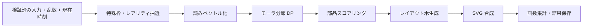
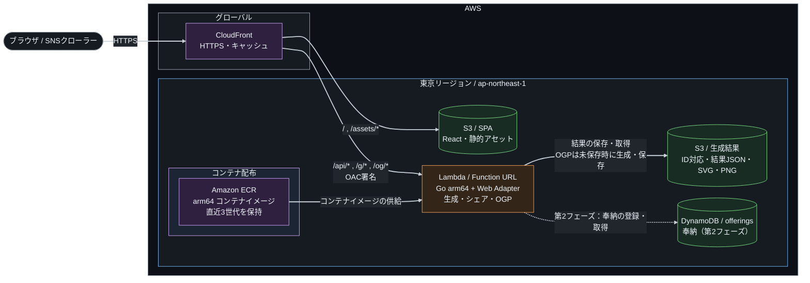

# 架空漢字ガチャ 仕様書

2026-09-22 · @Someone

## 1. 概要

かな5文字以内の「読み」を入力すると、その読みに合いそうな漢字部品を読みとの音の近さでスコアリングして選び、合成して漢字一字を生成する。生成される字の意味はユーザーに委ね、意味・語釈・由来は提供しない。実在字との一致判定も行わない。形態の複雑さはガチャ的に大きくばらつかせる。単純な二部品の字が大半だが、まれに数十画の「グチャグチャ」な字や、幽霊文字・たいと・びゃん系の都市伝説枠も出る。

技術面では、フロントを静的配信、生成ロジックを Go の単一バイナリに閉じ込め、AWS のサービス別無料枠を活用し、小規模運用の費用を抑える。同時に、技術記事で Go の強みを示す題材にもする。具体的には go:embed による辞書同梱、時間予算付きのランダム探索、goroutine による候補の並列生成、fuzzing、pure Go での SVG→PNG 変換を扱う。

MVP のスコープは、生成・表示・シェアリンク・OGP 画像の四つとする。全ユーザー共通の「登録辞書」は第2フェーズで扱う（4章）。

### 1.1 用語

本書で使う言語学・文字学の用語は次のとおり。

| 用語 | 意味 | 例 |
| --- | --- | --- |
| モーラ（拍） | 日本語の音の長さの単位。仮名1字がおおむね1モーラで、拗音は2文字で1モーラ | トウキョウ＝ト・ウ・キョ・ウの4モーラ |
| 拗音 | 小書きのャュョを伴う音 | キャ、ショ |
| 撥音・促音・長音 | それぞれン、ッ、ー。単独で1モーラを占める | カン、キッテ、ソー |
| 清音・濁音 | 濁点のない音と、ある音 | カとガ、サとザ |
| 子音行・母音段 | 五十音表の行（子音）と段（母音） | 「セ」はサ行・エ段 |
| 部首 | 辞書で漢字を分類するときの見出しになる部品 | 氵（さんずい）、木 |
| 偏・旁・冠・脚・繞・垂・構 | 部品が字の中で占める位置の呼び名。左・右・上・下・左から下・上から左・囲み | 偏＝氵、冠＝艹、繞＝辶、垂＝广、構＝囗 |
| 形声文字 | 意味を表す部品と、音を表す部品を組み合わせた字。漢字の大半を占める | 晴＝日（意味）＋青（音「セイ」） |
| 意符 | 形声文字で意味を担う部品 | 晴の「日」 |
| 音符 | 形声文字で音を担う部品 | 晴・清・精の「青」 |
| 同音異字 | 読みが同じで字が異なるもの | セイ＝晴・清・静 |
| 同字重ね | 同じ字を2〜4個並べて作った字 | 林、森、品、龘 |
| IDS | 漢字の部品配置を ⿰⿱ などの記号で書く記法（Ideographic Description Sequence） | 晴＝⿰日青 |
| 幽霊文字 | JIS 規格に入っているが、出典や用例が確認できなかった字 | 彁、妛 |

## 2. 入力仕様

入力モードは音読みと訓読みの二つで、タブで切り替える。受け付けるのは、NFKC 正規化とひらがな→カタカナ統一を行った後の全角カナだけとする。検証はフロントとバックエンドの両方で行い、正規化関数は Go 側を正とする。フロントでは同等の処理を TS で実装し、共通のテストベクタ（JSON）で両者の一致を保証する。

| 項目 | 音読みモード | 訓読みモード |
| --- | --- | --- |
| 入力欄 | 読み 1欄 | 読み（語幹）+ 送り仮名 の 2欄 |
| 文字数 | 1〜5文字かつ2モーラ以下 | 語幹 1〜5文字、送り仮名 0〜3文字、合計 6文字以内 |
| 許可文字 | カタカナ、長音「ー」、小書き（ァィゥェォャュョッ） | 同左 |
| 表示時の表記 | カタカナ（例: セイ） | ひらがな、送り仮名を括弧（例: あお（い）） |
| 拒否例 | 漢字・英数字・記号、先頭の「ー」「ッ」「ン」 | 同左 |

文字数は正規化後の Unicode コードポイント数で数え、拗音の「キャ」は2文字とする。音読みは中国語の1音節に由来し、かなで書くと3文字以下（3文字なら2文字目が小書きのャュョ）になるため、音読みモードの読みは2モーラ以下に限る（「セイ」「キョウ」は可、「トウキョウ」は不可）。3モーラ以上の読みは訓読みモードで受け付ける。[漢字文化資料館 Q0250](https://kanjibunka.com/kanji-faq/old-faq/q0250)

正規化済みのモード・読み・送り仮名の組を「正規化キー」と呼ぶ。モーラ列はスコアリング用に別途導出し、表記の異なるキーを勝手に同一視しない。キーは辞書検索と第2フェーズの奉納に使い、ID は独立した乱数で発行する。

### 2.1 厳密な受理条件

- JSON 本文は最大 1 KiB。UTF-8 不正、孤立サロゲート、JSON 構文不正、重複キーは 400、上限超過は 413、JSON 以外の Content-Type は 415。置換文字への自動変換で受理しない。
- `mode` は `on` / `kun` のみ、`reading` は必須の文字列。`okurigana` は省略時だけ空文字とし、null・数値・未知フィールドは 422。音読みモードの送り仮名は空文字だけ許可する。
- NFKC → ひらがなをカタカナへ変換 → 許可文字・長さ・並びの検証の順に処理する。前後の空白を含め空白は拒否し、自動 trim はしない。
- 正規化後の基本文字集合は `アイウエオカキクケコサシスセソタチツテトナニヌネノハヒフヘホマミムメモヤユヨラリルレロワヲンガギグゲゴザジズゼゾダヂヅデドバビブベボパピプペポヴヰヱ`。追加で `ァィゥェォャュョッー` を許可する。踊り字・中点・小書きヮヵヶ・単独の濁点等は拒否する。
- 読みと非空の送り仮名は、それぞれ単独で検証する。先頭の小書き・ー・ンは禁止。小書きの結合は、`[キギシジチヂニヒビピミリ][ャュョ]`、`[イウヴシジチツフテデトドクグ][ァィゥェォ]`、`[テデフヴ]ュ` の表に一致する2文字だけ許可する。これは入力文法の初期仕様であり、実在語かどうかは検証しない。
- `ッ` と `ン` は各1モーラ。`ッ` の直後に `ッ`・`ン`・`ー` は許可しない。`ー` は基本文字集合から `ン` を除いた文字、許可した2文字結合、または `ー` の後だけ許可する。末尾の `ッ` は許可する。小書き結合を最長一致で取り、許可された組に含まれない小書き母音・ャュョが残れば拒否する。それ以外の文字は1モーラずつに分ける。
- 並びの検証を通った後、音読みモードでモーラ数が3以上なら `reading` の `morae` エラーとする。文字位置は返さない。
- 語幹をまたいで送り仮名と小書きを結合しない。辞書にない読みも文法が正しければ受理する。
- 文字・並びのエラー位置は正規化後の各フィールド内の0始まりコードポイント位置で返し、正規化後の値も返す。型・欠落・長さのエラーはフィールド名とエラーコードを返し、文字位置は省略する。フロントはその値を対象にエラー位置を表示する。

共通テストには音読みの `きょう` の受理と `トウキョウ`・`アーー` の拒否、`ｷｬ→キャ`、`が→ガ`、`ゔぁ→ヴァ` の受理、空白・単独濁点・`ャク`・`キョャ`・`カッー`・送り仮名だけの `ゃ` の拒否、各文字数境界、未知フィールド、不正エンコーディングを含める。

## 3. 生成アルゴリズム

生成は毎回抽選し、同じ入力・同じ内部シードでも結果の再現は保証しない。POST の冪等性も保証せず、再送は新しい抽選として扱う。共有時は保存した結果を取得する。処理は「辞書の事前構築（オフライン）」と「リクエスト時の生成（オンライン）」の2段に分ける。



### 3.1 データソースと事前構築

部品と字形には [GlyphWiki](https://glyphwiki.org/) のダンプ（`dump.tar.gz`）を使い、明朝体の肉付けには KAGE エンジンを Go に移植した `internal/kage` を使う。読みには KANJIDIC2 の音読み・訓読みと送り仮名区切りを使い、意味フィールドは取り込まない。GlyphWiki のデータは改変・商用を含めて自由に利用・再配布でき、著作者表示の条件もない。KAGE エンジンは GPL v3 で、描画はサーバー側だけで行う（ブラウザに配らない）。KAGE データの形式は [GlyphWiki:KAGEデータ仕様](https://glyphwiki.org/wiki/GlyphWiki:KAGE%e3%83%87%e3%83%bc%e3%82%bf%e4%bb%95%e6%a7%98) を参照する。

`cmd/builddict` は次の手順で辞書を作る。

1. ダンプは tar.gz のまま読み、アーカイブ全体と KANJIDIC2 と上書き設定の SHA-256 を記録する。辞書の版はこの3つのチェックサムから作る。ダンプは毎日作り直され過去の版を取得できないので、構築に使ったものはリポジトリのリリース（`sources-YYYY-MM-DD`）に保管する。
2. 親字は、KANJIDIC2 に日本語の読みがあり、JIS X 0208 の字か常用・人名用の字（6,458字）とする。親字の字形は `uXXXX-j`（日本の字形）を優先し、なければ `uXXXX` を使う。KanjiVG を使っていたころの範囲（JIS X 0208 とその周辺）を保つためで、KANJIDIC2 の読みがある字をすべて（約1万2千字）親字にはしない。
3. 部品は3種類ある。親字の全体字形（`whole`）。位置別の変形部品 `uXXXX-0N`（`-01` 偏 left、`-02` 旁 right、`-03` 冠 top、`-04` 脚 bottom、`-05` 囲いの外 enclosure）で、日本の字形 `uXXXX-j0N` があればそちらを使う。部首の補助ブロックの字（⺨・⻖など）で、別名として他の字の変形部品を指すものも、その位置の部品とする。変形部品は、親字の参照に現れる字と部首の補助ブロックの字に限る。
4. 構・垂・繞は、親字での使われ方から見つける。親字の部品引用（`99`）のうち、外接矩形がほかの部分をすべて囲むもの（許容幅15%、内側が面積の3%以上）を囲いとして使われたとみなし、3字以上で使われたグリフを囲いの部品（enclosure）にする。内側の矩形は使われ方の中央値とし、囲いの外接矩形に対する比率で持つ。IDS 演算子は、内側の矩形から外へ伸ばした検査線が囲いの筆画と交わる辺（閉じた辺）から決める。`data/component-overrides.json` で、部品の ID ごとに除外・位置・演算子・内側の矩形を補正する。
5. 版を指定した参照（`名前@版`）は、ダンプの全版のファイルから読む。参照先が欠けた部品は除外して報告する。部品が参照するグリフは、すべて辞書に同梱する。
6. 部品の外接矩形は、参照を展開した筆画の制御点から求める（200×200 の KAGE の枠）。画数は手書きの画数とし、KANJIDIC2 の画数を使う。KANJIDIC2 にない字（部首の補助ブロックなど）は、前の筆画の終点から接続・カドの頭形状で始まる筆画を1画にまとめて推定する。KAGE の1筆画は手書きの1画と対応しない（口の ㇕ は直線2本）ためである。
7. 部品の読みと、部品を含む親字（参照を何段たどっても含むもの）の読みを集計する。出現頻度は部品の字を含む親字の数を親字の数で割る。
8. 部品表、読みベクトル、グリフの KAGE データを1つのバイナリ辞書（gzip した gob）へ出力し、`go:embed` で同梱する。既存字の IDS は導出しない。
9. ビルド報告に部品数（位置別）、囲いの数、読み付与率、同梱グリフ数、旧版の数、画数を推定した数、参照先が欠けた数を出す。通常生成の候補が空、または都市伝説枠の描画素材がない場合はビルドを失敗させる。

### 3.2 読みのベクトル化

読みは、モーラ単位の素性をハッシュして D=256 次元に写し、L2 正規化する（feature hashing）。素性には次のものを使う。

1. モーラ unigram・bigram と語頭モーラ
2. 子音行と母音段
3. 清濁・拗音・撥音・促音・長音の有無

子音・母音の素性があるので、完全一致しなくても「セイ」と「ゼイ」「ショウ」と「ソウ」は近いベクトルになる。部品の音ベクトルは、その部品を含む実在字の音読みベクトルの平均に、部品自身の読みを3倍の重みで加えたものとする。GlyphWiki には音符の注釈がないので、含む字の読みはすべて同じ重みで数える。氵や口のような遍在部品の寄与は、スコアの出現頻度の項（γ）で下げる。訓ベクトルも訓読みの音から同様に作る。意味に関する重みは設けない。

### 3.3 音符と意符

生成字は形声文字の構造をまねて、読みを担う**音符**1字と、読みと無関係な**意符**（偏・旁・冠・脚・垂・繞・構）で組む。実在字を読みで選んで並べるだけでは「合体」に留まるため、意符を音から切り離してランダムに引き、字形の創作性を出す。

音符は入力の読み全体（分節しない）に対して、実在字（`whole` の部品）を次のスコアで順位付けし、上位 k 字から softmax と温度 T で1字だけ抽選する。他の字の旁・脚として現れる字（青・干・生など）は、音符として自然に収まるので δ だけ加点する。

```latex
\mathrm{score}(c) = \cos(\mathbf{r}, \mathbf{c}_{\mathrm{mode}}) + \alpha\,\mathbb{1}[\text{c が読み r を持つ}] + \beta\,\mathbb{1}[\text{送り仮名一致}] - \gamma\,\mathrm{df}(c) + \delta\,\mathbb{1}[\text{旁・脚の字形がある}]
```

δ=0.3。訓読みモードでは語幹と送り仮名が一致する字（あお＋い→青）を優先する。T はレアリティに連動させ、高レアほど読みとの関連を緩める。

意符は `internal/compose/radicals.go` の候補表（氵亻扌艹宀辶广門など約110種）から引く。まず位置の種類を「偏 50%・冠 18%・旁 10%・脚 10%・垂 5%・繞 4%・構 3%」で抽選し、その種類の中で出現頻度の平方根に比例して字を選ぶ。同じ字は1字の中で重複させず、垂・繞・構は内側の1〜2層に1つまでとする。音符を核に、意符を内側から外側へ順に重ねる（⿰氵⿱艹青 など）。意符1つごとに木が1段深くなるため、深さの上限で意符が足りないときは音符の重ねを最大4個まで増やし、抽選した部品数を保つ。このため深さ d で作れる部品数は d=1 なら 2、d≥2 なら d+2 までで、設定の読み込み時にこれを超える部品数の上限を拒否する。

音符の字形は置き場所に合わせる。偏の右なら旁としての字形（晴の中の青）、冠の下なら脚としての字形を使い、なければ字全体を縮めて置く。

### 3.4 レアリティと複雑性

レアリティを最初に抽選し、部品数、木の深さ、温度を決める。確率と範囲は設定ファイルに置き、MVP の実物を見て手動調整する。以下は初期値である。深さは根から葉までの演算子数（単一部品は0）とする。

| レアリティ | 確率 | 部品数 | 木の深さ | 形態の傾向 |
| --- | --- | --- | --- | --- |
| N | 70% | 2 | 1 | 意符1つ＋音符の素直な形声風 |
| R | 20% | 3 | 2 | 意符2つを重ねる |
| SR | 7% | 4〜5 | 4 | 意符3〜4層の入れ子 |
| SSR | 2.5% | 6〜8 | 7 | 音符の同字重ね（1〜3個）を含む |
| UR | 0.5% | 9〜10 | 8 | 音符2〜4個の重ねと多層の意符 |

### 3.5 レイアウト木と合成

レイアウトは IDS 演算子（⿰⿱⿲⿳⿴⿵⿶⿷⿸⿹⿺⿻）のノードを持つ木で表す。意符の幅（偏・旁）や高さ（冠・脚）は、その字形の元の縦横比から決め、20〜45% の範囲に収める。意符は縦横比をほぼ保ち（伸長1.15倍まで）、音符は1.6倍までの伸長で残りの枠に収める。構・垂・繞は外接矩形全体に置き、内側の矩形は辞書が親字の使われ方から求めた相対座標で決める（親字で囲いとして使われていない部品は、垂・繞ごとの既定値を使う）。

配置は viewBox 109 単位で計算し、結果を部品ごとの部品引用行（`99:0:0:x1:y1:x2:y2:グリフ名`）に変換して、1字分の KAGE データにする。部品の外接矩形が枠に収まるように、200 の枠全体の写し先を逆算する。単位の変換はこの1か所で行う。KAGE は部品矩形の座標を整数に切り捨てるので、部品の位置は最大1単位ずれる。

組み上がった KAGE データは、一度に展開して肉付けする。KAGE は筆画同士の接続や、近い縦画の細め・ウロコの縮小などの自動調整を字全体で行うため、部品ごとに別々に描かない。KAGE の線幅は字の大きさによらず一定なので、そのまま縮めた部品はつぶれる。そこで部品ごとに、元の大きさに対する縮小率 s（縦横の相乗平均）から線の太さ w = clamp(s^0.7, 0.35, 1) を決め、その部品の筆画の線幅と飾り（ウロコ・カカト・ハネ）を w 倍にして描く。自動調整の判定は元の太さのまま行う。

出力は 200×200 の viewBox を持つ SVG で、KAGE の1筆画を塗りつぶしの `path` 1つにする（筆画内で重なる多角形は向きをそろえ、nonzero で塗る）。描画順は部品内のデータの順で、部品間はレイアウト木の走査順である。正しい筆順を保証するものではない。

保存済みの旧形式（KanjiVG の中心線を線幅2.5で描いた 109×109 の SVG）は、そのまま表示し、OGP 画像も描ける。

### 3.6 配置パラメータと表示

`config/generator.json` に次の初期値を置き、Go の設定構造体から参照する。値の変更はコード修正不要とし、MVP で一覧画像を作って手動調整する。品質の目標値と、処理を必ず止める上限を分ける。

| パラメータ | 初期値・動作 |
| --- | --- |
| 配置の単位 / 外周余白 | 109×109 / 8。描画は 200×200 の KAGE の枠 |
| 部品間隔 / 最小スロット寸法 | 5 / 8（配置の単位） |
| 左右・上下の分割比 | 原則 0.35〜0.65、偏は 0.35〜0.45 |
| 部品数 / 深さ / 総画数の上限 | 16 / 8 / 160。画数は重複配置した部品も加算 |
| 候補生成数 / 並列数 / 生成時間 | 最大32候補 / 2 / 200ms（保存時間は別） |
| 候補部品 top-k / 温度 | 16 / N=0.3, R=0.5, SR=0.8, SSR=1.1, UR=1.5 |
| スコア係数 α / β / γ | 0.5 / 0.25 / 0.1。df は収録字数で割った頻度 |
| 有効な配置 | ⿰⿱⿲⿳、内側の矩形がある囲み・繞・垂。⿻は初期無効 |

囲み等は、外側の字形を置く矩形に対する内側部品の矩形を0〜1の相対座標で保持する。内側の矩形がない部品はその役割に配置しない。重なり・最小間隔違反は候補の減点に使い、有限座標・描画領域内・各上限以下は必須条件とする。制御点の外接矩形が余白の内側（部品矩形の丸めの1単位を除く）にあることを確認する。多画数の密度や見栄えの閾値は試作後に調整する。

最初に意符1つ（N 相当）の有効な退避候補を用意し、時間内の有効候補から枠の窮屈さの減点が最も小さいものを選ぶ。画数では順位を付けない（画数の少ない構えばかり残るのを防ぐ）。高レアの目標画数や部品数を満たせない場合も抽選レアリティは保持し、実際の画数・構成を返す。退避結果の割合は内部計測し、パラメータ調整に使う。退避候補も得られなければ 503 とする。

IDS は生成した配置木を記述するためだけに使う。結果には読み・字形・画数・構成を表示し、意味、実在／非実在、収録範囲内で未発見といった判定表示は設けない。

### 3.7 都市伝説枠

通常の抽選とは別に、特殊枠を判定する。条件と内容は次のとおり。

1. 特定入力：「タイト」などは、実在の多画数字を**返す**
2. 幽霊文字枠：確率 0.3% で、JIS X 0208 の典拠不明字（彁・妛など）を返す
3. 丑三つ時：JST 2:00〜2:30 は幽霊文字枠の確率を 10倍にする

特定入力を最優先し、それ以外で幽霊文字枠を抽選する。時刻条件は POST 受付時の JST 02:00以上02:30未満とし、通常の0.3%を3%にする。通常レアリティ表は特殊枠に入らなかった場合の条件付き確率である。特殊枠のレアリティは素材表で指定する。解説文や由来は付けず、生成時刻と枠の識別子は結果JSONに保存する。特殊枠も通常と同じ保存・表示経路を通す。IDSや画数が確定しない素材は該当値を null にし、値のない表示を省略する。

## 4. 永続化とシェア

MVP は再生成自由とシェアリンクで構成する。生成結果は毎回 S3 に保存する。同じ入力を再送して別の字が出ることを許容し、共有リンクは保存済みの結果を指す。共通辞書は第2フェーズで「奉納」機能として追加する。

### 4.1 グリフ ID と対応関係の保存

`crypto/rand` で16バイトを生成し、32文字の小文字16進数を ID とする。シード・入力・時刻をIDへ埋め込まず、暗号化と復号鍵は不要とする。公開APIではシードを受け付けず、返さない。

`glyphs/{id}.json` を唯一の結果レコードとし、ID、保存スキーマ版、生成器版、設定版、辞書版、正規化キー、表示用読み、生成日時、レアリティ、部品IDと配置木、IDS、画数、SVG文字列、特殊枠識別子、OGP用文字列、ライセンス情報、OGPオブジェクトキー `og/{id}.png` を保存する。これで入力・結果・画像の対応を明示的に保持し、別の索引DBや内容アドレス管理は導入しない。

POST は結果JSONの S3 保存成功後に200を返す。IDの衝突時だけ新IDで保存し直す。保存失敗は503とし、未保存の共有リンクを返さない。保存後に通信が切れた場合の再送は新規生成として扱い、前回結果の回収や重複排除はしない。保存済みレコードは `If-None-Match: *` の条件付きPUTで上書きを防ぐ。

### 4.2 取得・OGP・互換性

- `GET /api/v1/glyphs/{id}` と `/g/{id}` は結果JSONを取得する。字形を再抽選・再生成しない。ID形式不正は400、存在しないIDは404、S3障害は503とする。
- `/og/{id}.png` は CloudFront → Lambda。S3にPNGがあればその画像を返し、なければ結果JSON内のSVG・表示情報からPNGを生成してS3へ保存して返す。結果自体がなければ404とし、勝手に抽選しない。
- 同時の初回OGP要求による重複レンダリングは許容する。PNGは条件付きPUTで最初の保存を採用し、競合した側は保存済みPNGを返す。画像生成・保存に失敗したら503とし、エラーはキャッシュしない。
- PNGの生成は字形生成の200ms予算とは別に扱い、初期上限は3秒。Lambda全体のタイムアウトは10秒とし、I/Oにも残り時間を渡す。
- 生成器の旧版同梱は不要。生成器・辞書・設定の版は調査用メタデータとして残し、保存スキーマには必要な読み取り互換性を持たせる。OGPテンプレートの更新前後で、未生成画像の見た目が変わることは許容する。
- 結果JSONとPNGには自動期限削除を設定しない。保存とサービスを維持する間はリンクを有効にする。全生成結果を保存するので、費用は未共有の生成分も含めて計算する。

### 4.3 奉納（第2フェーズ）

奉納では、DynamoDB のテーブル `offerings` にキー = 正規化キー、属性 = グリフ ID・奉納日時を条件付き書き込み（`attribute_not_exists`）で保存する。条件付き書き込みにより、先着一件だけが確定する。同じ読みで入力したときは、ガチャ結果の横に「奉納字」を並べて表示する。

## 5. API 仕様

API の正は OpenAPI 3.1 のスキーマ（`api/openapi.yaml`）とする。Go のサーバースタブは oapi-codegen で、TS の型は openapi-typescript で生成する。フロントとバックエンドは同じ CloudFront 配下に置くので、CORS は不要になる。

| メソッド・パス | 用途 | キャッシュ | フェーズ |
| --- | --- | --- | --- |
| `POST /api/v1/glyphs` | 生成（シードはサーバー側で乱数生成し、外部から指定できない） | なし | MVP |
| `GET /api/v1/glyphs/{id}` | 保存結果の取得 | CloudFront 1年（immutable） | MVP |
| `GET /g/{id}` | シェアページ（OGP メタタグ入りの HTML を返し、SPA を読み込む） | 1日 | MVP |
| `GET /og/{id}.png` | OGP 画像 1200×630（Lambda経由） | S3永続保存、CloudFront成功応答1年 | MVP |
| `POST /api/v1/offerings` | 奉納 | なし | 第2 |
| `GET /api/v1/offerings/{key}` | 奉納字の取得 | 5分 | 第2 |

生成リクエストとレスポンスの例は次のとおり。

```json
// POST /api/v1/glyphs
{ "mode": "kun", "reading": "あお", "okurigana": "い" }

// 200 OK
{
  "id": "a13c02f56b984e7d90ab12cd34ef5678",
  "generatorVersion": 1,
  "reading": { "mode": "kun", "display": "あお（い）", "morae": ["ア", "オ"] },
  "rarity": "SR",
  "ids": "⿰氵⿱青⿴囗月",
  "strokes": 18,
  "svg": "<svg viewBox=\"0 0 200 200\">…</svg>",
  "components": [
    { "char": "氵", "role": "reading", "score": 0.31 },
    { "char": "青", "role": "reading", "score": 0.94 },
    { "char": "囗", "role": "decor", "score": 0.20 },
    { "char": "月", "role": "decor", "score": 0.22 }
  ],
  "legend": null
}
```

エラーは RFC 9457（Problem Details）形式で返す。バリデーションエラーは 422 で、どの欄のどの文字が不正かを返す。レート制限は 429 とする。生成には 200ms のタイムアウトを `context` で掛け、超えた場合はその時点の最良候補を保存して返す（3.6）。POST とエラー応答は `Cache-Control: no-store` とし、CloudFrontでもエラーキャッシュを無効にする。意味の説明や実在判定のフィールドは設けない。

## 6. フロントエンド仕様

構成は pnpm + Vite + React + TypeScript の SPA とし、S3 に静的配信する。ルーティングは `/`（生成画面）と `/g/:id`（シェア閲覧）の2画面だけなので、TanStack Router などは入れず、軽量なルーター（wouter 程度）で足りる。状態管理は TanStack Query に寄せ、グローバルストアは持たない。

画面はホーム（`/`）と結果（`/g/:id`）の2つで、どちらも98.css のウィンドウ1枚の中に縦一列で要素を並べ、ライセンス表示はステータスバーに置く。生成に成功したら `/g/:id` へ遷移し、ブラウザの戻る操作でホームへ戻れるようにする。

| 画面 | 要素（上から順） |
| --- | --- |
| ホーム | アプリ名、入力（モードタブ、読み欄。訓は送り仮名欄を横に追加）、生成ボタン、ライセンス表示 |
| 結果 | 字形の画像（読みを添える）、共有リンク（URL と共有ボタン）、ベース、ホームへ戻るリンク、ライセンス表示 |

| 要素 | 仕様 |
| --- | --- |
| 入力フォーム | IME 変換中（compositionstart〜end）は検証を保留し、エラーは入力欄の下に表示する |
| 生成ボタン | 連打防止、生成中はスピナーを表示する（最短400ms） |
| 表示演出 | 結果の表示時にウィンドウを bounceIn、字形の枠を rubberBand で弾ませ、レアリティごとの候補から1種類の絵文字を選び、N 18個〜UR 130個をウィンドウの周囲（外側56px まで）で下から打ち上げる。書き順の描画が終わるまで射出を続け、1個あたり3.2〜5秒かけて上がる。`prefers-reduced-motion` のときは無効 |
| 字形の画像 | 生成直後だけ、KAGE の1筆画（`path`）ずつ順に現れる（1画180ms、間隔は最大130msで全体を約2.6秒に収める）。保存済みの旧形式（線の SVG）は `stroke-dashoffset` で線をなぞる。`prefers-reduced-motion` のときは無効 |
| 共有リンク | Web Share API を優先し、非対応ならリンクをコピーする |
| ベース | 結果の `components` のうち `role=reading` の字を重複なく並べる。該当がなければ表示しない |

シェアページ `/g/:id` の HTML は、クローラーが JS を実行しない前提で、Lambda が OGP メタタグを埋めて返す。本体はその HTML から SPA のバンドルを読み込む。SVG には `role="img"` と、IDS と読みを含む `aria-label` を付ける。生成字には通常の文字コードがないためである。

## 7. アーキテクチャ・インフラ・コスト

構成は CloudFront 一枚の下に S3（SPA）と Lambda Function URL（Go API・シェア・OGP）を並べ、結果JSONとPNGを非公開S3に保存する。初年度無料枠や新規アカウントのクレジットは費用の前提にしない。常時課金の App Runner、Fargate、Lightsail は使わない。



図は実行時のリクエスト経路とコンテナイメージの配置元を示す。通常の実線はMVPのリクエスト経路、点線は第2フェーズ、太線はECRからLambdaへのイメージ供給を表す。結果保存用S3へのアクセスはLambdaが担当し、`/og/*` もLambdaを経由する。LambdaはVPC接続を前提としないため、VPC・サブネットの枠は設けない。GitHub Actionsがビルドしたarm64イメージをECRへpushし、そのイメージを指定してLambdaを更新する。ECRへのアクセスはユーザーリクエストごとには発生しない。CI/CDの詳細経路と運用監視はこの図から省略する。

Lambda のオリジンには Function URL を使い、CloudFront の OAC で署名付きアクセスに限定する。API Gateway は使わないので、その分の課金とレイテンシがなくなる。サーバーは通常の `net/http` サーバーとして書き、AWS Lambda Web Adapter で Lambda に載せる。これで、ローカルの Docker でも Lambda でも同じバイナリがそのまま動く。

OAC は [AWS公式手順](https://docs.aws.amazon.com/AmazonCloudFront/latest/DeveloperGuide/private-content-restricting-access-to-lambda.html) に従い、Function URL は `AWS_IAM`、OACは常時署名、Lambda権限は対象distributionのARNに限定する。必要な `lambda:InvokeFunctionUrl` と `lambda:InvokeFunction` を設定する。フロントはJSONを一度だけ文字列化し、そのUTF-8バイト列のSHA-256を小文字16進数にして `x-amz-content-sha256` に入れ、同じバイト列をPOSTする。CloudFrontはOACの署名にこのヘッダーの値を使う（origin request policyには指定できないため入れない）。POSTを許可、`/api/*` の生成応答をキャッシュしない。本文とハッシュが異なる場合の拒否も実AWSの結合確認に含める。GETのキャッシュ設定とは分ける。

### 7.1 Docker の位置づけ

本番もコンテナイメージでデプロイする。Go のバイナリを scratch（または distroless）に載せた arm64 イメージを ECR に置き、Lambda で実行する。イメージ容量は辞書・フォント・Web Adapter込みで実測する。ECR のライフサイクルポリシーで直近3世代を残し、7.2では合計0.3GBを仮置きする。同じイメージを `docker compose` によるローカル開発（API、DynamoDB Local、MinIO）と CI の E2E でも使うので、開発・検証・本番で実行環境が揃う。

### 7.2 月額コストの目安

2026-09-22 に公式料金を確認。初年度無料枠がなくても、LambdaとCloudFront従量課金のサービス別無料枠はある。対象アカウントで他用途と共有する枠の残量は未確認。リージョンは東京（ap-northeast-1）、CloudFrontは従量課金を前提とし、S3・ECRは最初から有料で見積もる。

| 項目 | 前提・課金の扱い |
| --- | --- |
| CloudFront | 月1TBのインターネット向け転送・1,000万HTTP(S)リクエストのAlways Free枠。超過分・対象外の通信等は別途課金 |
| Lambda | 月100万リクエスト・40万GB秒の無料枠。生成だけでなくGET、OGP、起動・I/Oを含む実際の課金時間で計算 |
| S3 Standard | 結果JSONとPNGの累積容量、PUT/GET課金。初年度無料は見込まない |
| ECR | 保存料の目安0.10 USD/GB月。3世代合計0.3GBなら約0.03 USD/月。転送・スキャン等の追加機能は別 |
| CloudWatch | ログ保持7日、リクエスト本文やSVGは記録しない。Logs・メトリクスの利用分を別計上 |
| DynamoDB | 第2フェーズで再見積もり。25GBのストレージ枠からオンデマンド読書きが無料とは判断しない |
| Route 53 | MVPでは利用せず0円。独自ドメイン費用も含めない |

試算用の利用量は、月1万生成、結果JSON（SVG込み）平均30KB、初回OGP生成1,000件・PNG平均100KBとする。月の追加保存量は約0.4GB、PUTは約1.1万件。削除しなければ12か月分で約4.8GBになる。API等のLambda実行を月5万回・平均0.5秒・1GBと仮定すると2.5万GB秒で、上記無料枠内に収まる。

S3の概算用単価を容量0.03 USD/GB月、PUT 0.005 USD/1,000件、GET 0.0004 USD/1,000件として丸めて置くと、初月の月末容量を丸一月保存した計算で容量0.012 USD、PUT 0.055 USD、GETを5万回として0.02 USD、ECRと合わせて約0.12 USD/月。これは東京の確定見積書ではなく規模感の試算で、ログ・メトリクス・税・対象外転送は別。公開前に東京の実単価と実測容量へ置換する。小規模時は月1 USD程度を予算目安にし、無料を保証しない。全件保存なので生成数に応じてPUT費用と累積容量が増える。

公式参照：[Lambda料金](https://aws.amazon.com/lambda/pricing/)、[CloudFront従量課金](https://aws.amazon.com/cloudfront/pricing/pay-as-you-go/)、[S3料金](https://aws.amazon.com/s3/pricing/)、[ECR料金](https://aws.amazon.com/ecr/pricing/)。

### 7.3 コストと濫用の防御

AWS WAF は月額の固定費が掛かるので使わず、次の四つで防ぐ。

1. Lambda の予約同時実行数を 10 に制限する
2. アプリ内で IP 単位のトークンバケットを持つ（インスタンス単位の緩い制限）
3. `GET /api/v1/glyphs/{id}` と OGP は CloudFront でキャッシュする
4. AWS Budgets で 1 USD 超過時にメール通知する

予約同時実行数は総利用量の上限ではなく、インスタンス内の制限も厳密な全体制限ではない。予算通知は自動停止しない。運用用に新規生成を503で止める設定を持ち、費用急増時は切り替える。保存済み結果の閲覧は継続する。

IaC は Terraform（OpenTofu 互換）とし、GitHub Actions から OIDC で AWS ロールを引き受ける。長期のアクセスキーは発行しない。

初期リリースは CloudFront が自動で割り当てるドメイン（`*.cloudfront.net`）で公開し、Route 53 は使わない。シェアリンクと OGP の URL は環境変数 `BASE_URL` から組み立てるので、後で独自ドメインに移すときも設定の変更だけで済む。

## 8. テスト戦略（TDD）と CI

TDD は、依存の少ない純関数から外側へ向かう順で進める。入力検証と保存契約を重点的に検証する。単体テストには乱数・時計を注入するが、生成結果の完全再現性やPOSTの冪等性は検証対象にしない。

| 順 | 対象 | 主なテスト手法 |
| --- | --- | --- |
| 1 | 正規化（`internal/kana`） | テーブル駆動テスト、FE/BE 共通のテストベクタ JSON、`go test -fuzz`（不正 UTF-8、結合文字） |
| 2 | 読みベクトル化 | 性質テスト（ノルムが 1、「セイ」と「ゼイ」の類似度が「セイ」と「ハク」より高い） |
| 3 | 分節 DP・スコアリング | 小さな手書き辞書フィクスチャで期待する部品順を検証 |
| 4 | レアリティ抽選 | シード固定で 10万回抽選し、各階級の比率を χ² 検定（有意水準 0.001） |
| 5 | レイアウト木・IDS 直列化 | IDS の往復変換、fuzz で「不正な木を作らない」性質 |
| 6 | SVG 合成 | KAGE エンジンの参照実装（`@kurgm/kage-engine`）で描いた座標との一致（`internal/kage/testdata/golden.json.gz`、Node はテストデータの作成時だけ使う）、SVG と OGP の読み戻し、旧形式の SVG の描画 |
| 7 | 辞書構築・保存・OGP | 分割部品と曖昧群の処理、ID→JSON→PNGの対応、保存失敗、OGP初回・既存・同時要求、旧結果の取得 |
| 8 | HTTP ハンドラ | `httptest` と OpenAPI スキーマ検証（レスポンスが契約どおりか） |
| 9 | フロント部品 | Vitest + React Testing Library、API は MSW でモック |
| 10 | E2E | Playwright 3〜5本（生成→シェア→再表示、IME 入力、エラー表示） |

代表的な200の入力について字形一覧・画数分布・退避率・生成時間を出し、辞書とパラメータ変更時に目視比較する。乱数を固定できる診断モードは設けるが、出力ハッシュ一致をリリース条件にはしない。入力の受理・拒否、座標・上限の不変条件、保存済み結果の取得互換性はCIで検証する。ベンチマーク（`go test -bench`）の結果は benchstat で main と比較し、PR にコメントする。

| ワークフロー | トリガー | 内容 |
| --- | --- | --- |
| `ci.yml` | PR | golangci-lint、`go test -race`、短時間 fuzz（30秒）、Biome、Vitest、型チェック、カバレッジ閾値（BE 80%） |
| `e2e.yml` | PR（ラベル付き）・main | docker compose で起動し Playwright |
| `deploy.yml` | main への push（CI成功後） | Terraform plan/apply（OIDC）、イメージを ECR へ push して Lambda 更新、S3 同期、CloudFront 無効化 |
| `fuzz-nightly.yml` | 毎日 | fuzz を 10分実行し、見つかったコーパスを Issue 化 |

## 9. パッケージ構成

パッケージは次のように分ける。

| パッケージ | 役割 |
| --- | --- |
| `cmd/api` | サーバーの起動。設定・辞書・S3・ハンドラを組み立てる |
| `cmd/builddict` | 辞書の構築（3.1） |
| `config` | `config/generator.json` の読み込みと検証（3.6） |
| `internal/kana` | 入力の正規化と検証（2章） |
| `internal/vector` | 読みのベクトル化（3.2） |
| `internal/dict` | 辞書の型・構築処理と、`go:embed` で同梱した辞書の読み込み |
| `internal/compose` | 抽選・部品選択・レイアウト木・候補探索（3.3〜3.7） |
| `internal/kage` | KAGE エンジンの Go 移植（GPL v3） |
| `internal/render` | SVG の出力・読み戻しと、OGP の PNG 描画 |
| `internal/model` | 結果レコードや配置木など、パッケージ間で共有する型 |
| `internal/glyphid` | グリフ ID の発行（4.1） |
| `internal/store` | S3 への保存・取得 |
| `internal/httpapi` | HTTP ハンドラ、レート制限、エラー応答（5章） |
| `internal/metrics` | CloudWatch の埋め込みメトリクス形式（EMF）でのログ出力 |

入力・スコア・合成のコアはHTTP/AWSから独立させ、乱数・時計・設定を引数で受ける。S3のI/Oは `internal/store` に、HTTPは `internal/httpapi` に隔離し、コアを単体でテストできるようにする。
